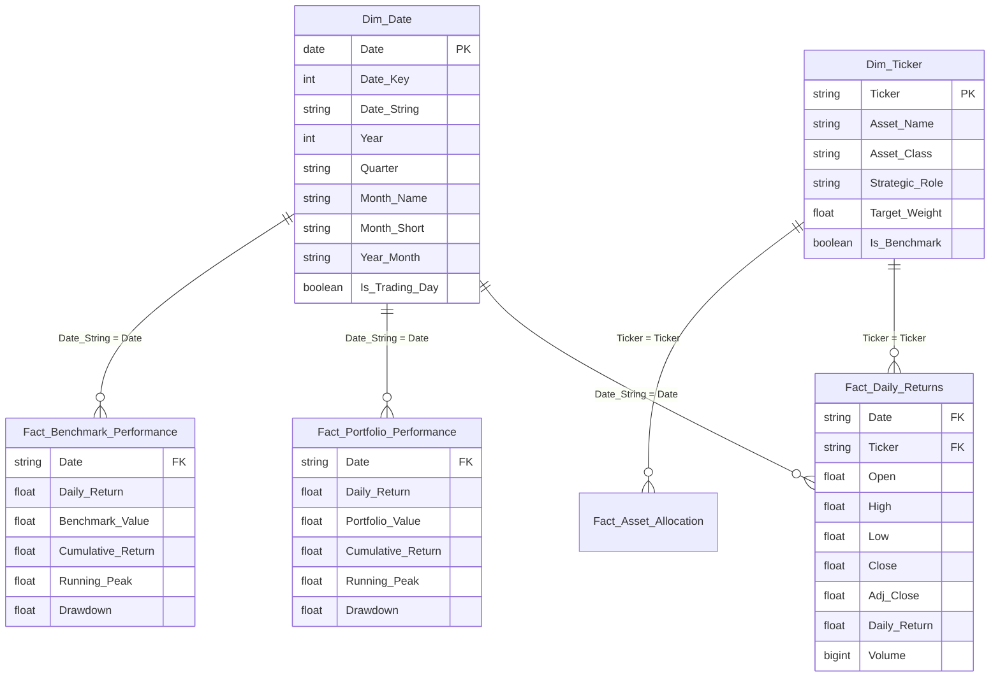

# Power BI Star Schema Data Model Architecture

## 1. Architectural Overview

The Power BI data model is engineered following **Kimball dimensional modeling** principles, utilizing a clean **Star Schema** with designated Dimension and Fact tables. This structure maximizes VertiPaq compression performance, eliminates circular dependencies, and ensures high-speed interactive cross-filtering across 5 years of daily financial observations.

---

## 2. Table Specifications & Cardinalities

### 1. `Dim_Date` (Calendar Dimension)
- **Role**: Conformed date dimension providing time-series navigation, slicing, and temporal intelligence.
- **Granularity**: 1 record per calendar day (including trading holidays and weekends).
- **Primary Key**: `Date` / `Date_String`
- **Configuration**: Marked as **Official Date Table** in Power BI Desktop (`Dim_Date[Date]`).
- **Sort By Settings**:
  - `Month_Short` sorted by `Month` (prevents alphabetical sorting like "Apr, Aug...").
  - `Quarter_Year` sorted by `Date`.
  - `Day_of_Week` sorted by `Day_of_Week_Number`.

### 2. `Dim_Ticker` (Asset Universe Dimension)
- **Role**: Categorical metadata for all ETF instruments in the portfolio and benchmark universe.
- **Granularity**: 1 record per ETF instrument (`SPY`, `QQQ`, `AGG`, `GLD`, `VNQ`).
- **Primary Key**: `Ticker`
- **Fields**: `Ticker`, `Asset_Name`, `Asset_Class`, `Strategic_Role`, `Target_Weight`, `Target_Weight_Pct`, `Is_Benchmark`.

### 3. `Fact_Daily_Returns` (Holdings Daily Observations)
- **Role**: Daily trading observations and return series for individual ETFs.
- **Granularity**: 1 record per `(Date, Ticker)` pair.
- **Foreign Keys**:
  - `Date` $\rightarrow$ `Dim_Date[Date_String]` (Many-to-One, Single Filter Direction)
  - `Ticker` $\rightarrow$ `Dim_Ticker[Ticker]` (Many-to-One, Single Filter Direction)

### 4. `Fact_Portfolio_Performance` (Portfolio Timeseries)
- **Role**: Aggregated constant-weight multi-asset portfolio daily valuation, returns, and drawdown.
- **Granularity**: 1 record per trading day.
- **Foreign Key**: `Date` $\rightarrow$ `Dim_Date[Date_String]` (Many-to-One, Single Filter Direction).

### 5. `Fact_Benchmark_Performance` (SPY Benchmark Timeseries)
- **Role**: S&P 500 benchmark ETF daily valuation, cumulative return, and drawdown.
- **Granularity**: 1 record per trading day.
- **Foreign Key**: `Date` $\rightarrow$ `Dim_Date[Date_String]` (Many-to-One, Single Filter Direction).

### 6. `Fact_Risk_Metrics` (Scorecard Dimensionless Fact)
- **Role**: Pre-aggregated summary metrics for immediate executive scorecard and KPI visual display.

### 7. `Fact_Asset_Allocation` (Allocation Fact)
- **Role**: Snapshot summary of target weight, CAGR, and volatility per holding.
- **Foreign Key**: `Ticker` $\rightarrow$ `Dim_Ticker[Ticker]` (Many-to-One).

---

## 3. Relationship Matrix

| Primary / 1-Side Table | Primary Key | Foreign / Many-Side Table | Foreign Key | Cardinality | Cross Filter | Active |
|---|---|---|---|---|---|---|
| `Dim_Date` | `Date_String` | `Fact_Daily_Returns` | `Date` | 1 to Many (1:*) | Single | Yes |
| `Dim_Date` | `Date_String` | `Fact_Portfolio_Performance` | `Date` | 1 to Many (1:*) | Single | Yes |
| `Dim_Date` | `Date_String` | `Fact_Benchmark_Performance` | `Date` | 1 to Many (1:*) | Single | Yes |
| `Dim_Ticker` | `Ticker` | `Fact_Daily_Returns` | `Ticker` | 1 to Many (1:*) | Single | Yes |
| `Dim_Ticker` | `Ticker` | `Fact_Asset_Allocation` | `Ticker` | 1 to 1 (1:1) / 1:* | Single | Yes |

---

## 4. Best Practices Implemented

1. **Star Schema Architecture**: No many-to-many bi-directional joins. Fast querying in tabular format.
2. **Dedicated Date Hierarchy**: Full continuous dates allow standard time-intelligence functions (`DATESYTD`, `DATEADD`, `SAMEPERIODLASTYEAR`).
3. **Data Type Consistency**: All currency columns typed as `Currency` (`$#,##0.00`), returns as `Percentage` (`0.00%`), and ratios as `Decimal` (`0.00`).
